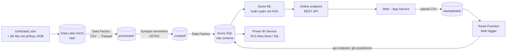

# Dự đoán sinh viên bỏ học trên Microsoft Azure

Đồ án môn **Điện toán đám mây** – mã lớp **IS402.R11**
Trường Đại học Công nghệ Thông tin – ĐHQG-HCM

| | |
|---|---|
| Giảng viên hướng dẫn | Hà Lê Hoài Trung |
| Học kỳ | HK1 năm học 2026–2027 |
| Đề tài | Bài tập 03 – Phân tích và trực quan dữ liệu sinh viên bỏ học |

## Thành viên nhóm

| | Họ và tên | MSSV | Phụ trách |
|---|---|---|---|
| TV1 | Nguyễn Minh Thi | 23521474 | Data Platform: thu thập, Data Lake, ETL (Data Factory + Synapse), mô hình dữ liệu Azure SQL, benchmark và tối ưu lưu trữ |
| TV2 | Nguyễn Minh Thư | 23521542 | Analytics & Model: EDA, feature engineering, huấn luyện và so sánh mô hình trên Azure ML |
| TV3 | Phạm Thị Phương Anh | 22520070 | Serving & App: triển khai endpoint, web dự đoán (App Service), Azure Function, kiểm thử tích hợp |
| TV4 | Đinh Nguyễn Khánh Quỳnh | 23521331 | Insight & Quản trị: Power BI (RLS, cập nhật tức thời, mobile), đo độ trễ giữa các region, chi phí và quota |

## Bài toán

Sinh viên bỏ học gây tổn thất cho nhà trường và xã hội. Đồ án xây dựng hệ thống trên Azure để **dự đoán sinh viên năm nhất có nguy cơ không quay lại năm hai**, giúp nhà trường phát hiện sớm và hỗ trợ kịp thời. Đây là bài toán **phân loại nhị phân**.

- **Dữ liệu:** Kaggle *Students' Early Attrition Analysis* (`UnivData1.xlsx`, giấy phép CDLA-Sharing 1.0) – 3.400 sinh viên năm nhất khóa 2005–2010, 56 cột (nhân khẩu học, điểm đầu vào, điểm từng môn học kỳ 1 và 2, tín chỉ, tài chính).
- **Nhãn:** `dropout = 1 − RETURNED_2ND_YR`; tỉ lệ bỏ học 21,3%.
- **Dữ liệu mô phỏng:** để đạt quy mô >4GB, nhóm sinh thêm 17,6 triệu sinh viên mô phỏng (4,36 GB) bằng cách lấy mẫu lại từ dữ liệu thật và thêm nhiễu. Dữ liệu mô phỏng chỉ dùng cho lưu trữ, ETL và benchmark; **mô hình chỉ huấn luyện trên 3.400 sinh viên thật** (`is_synthetic = 0`).

Chi tiết cột, nhãn và quy tắc: [`data/data_contract.md`](data/data_contract.md). Danh sách feature: [`ml/feature_spec.md`](ml/feature_spec.md).

## Kiến trúc

| Dịch vụ | Vai trò | Mô hình |
|---|---|---|
| Azure Data Lake Storage Gen2 | Lưu dữ liệu theo 3 zone `raw/`, `processed/`, `curated/` | PaaS |
| Azure Data Factory | Điều phối ETL, trigger theo lịch và theo sự kiện | PaaS |
| Azure Synapse Analytics (serverless SQL) | Tiền xử lý và tổng hợp trực tiếp trên Data Lake | PaaS |
| Azure SQL Database | Star schema 13 bảng, nguồn dữ liệu cho Power BI và mô hình | PaaS |
| Azure Machine Learning | Huấn luyện, đăng ký và triển khai mô hình | PaaS |
| Azure App Service | Web dự đoán | PaaS |
| Azure Functions | Xử lý file CSV người dùng upload | FaaS |
| Power BI Service | Dashboard, phân quyền theo vai trò (RLS) | SaaS |

## Cấu trúc repo

| Thư mục | Nội dung | Phụ trách |
|---|---|---|
| `data/` | Script sinh dữ liệu, data contract, ánh xạ ngành → khoa, bảng dung lượng | TV1 |
| `etl/sql/` | DDL star schema trên Azure SQL | TV1 |
| `etl/results/` | Số đo benchmark đọc/ghi và tối ưu | TV1 |
| `synapse/` | Script Synapse: tạo database, view, CETAS, benchmark, profiling | TV1 |
| `adf/` | Pipeline, dataset, linked service, trigger của Data Factory (Git integration) | TV1 |
| `synapse-studio/` | Cấu hình Synapse Studio (Git integration) | TV1 |
| `docs/` | ERD (`erd.dbml`, `erd.png`) | TV1 |
| `ml/` | Notebook EDA, mã huấn luyện và đánh giá, feature spec, script deploy endpoint | TV2, TV3 |
| `web/` | Web Flask: trang chủ, dự đoán 1 sinh viên, upload CSV, lịch sử dự đoán | TV3 |
| `function/` | Azure Function xử lý file upload | TV3 |
| `api/`, `postman/` | Dữ liệu kiểm thử và Postman collection | TV3 |
| `perf/` | Script và kết quả đo độ trễ giữa các region | TV4 |
| `powerbi/` | Report Power BI (định dạng PBIP) | TV4 |
| `infra/` | File export cấu hình tài nguyên Azure (JSON) theo từng buổi làm | Cả nhóm |

